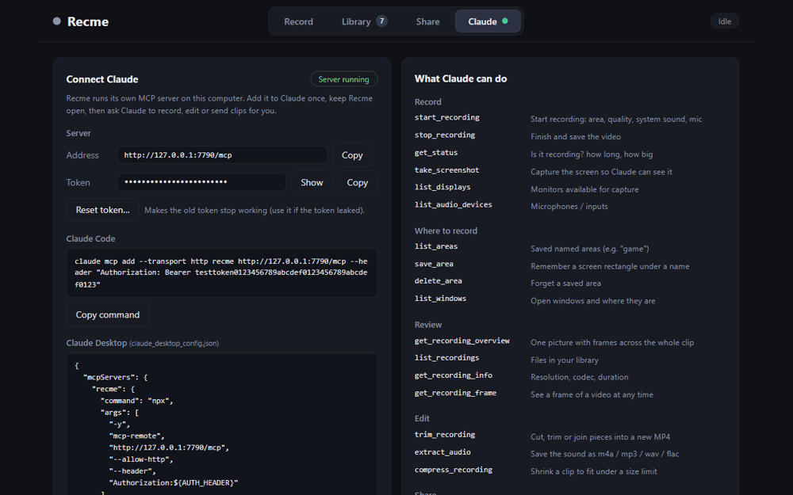

# Recme

**A screen recorder for Windows that Claude can drive.** Recme has its own MCP server built in: connect it once and Claude can start and stop recordings, look at screenshots and frames of what it recorded, cut and rearrange clips, pull the audio out, shrink a file for sharing, and send it to a nearby device. Sharp native-resolution capture, record any area you drag out (or a saved one by name), built-in editor, Wi-Fi sharing. Everything stays on your computer.

### ⬇️ [Download Recme for Windows](https://github.com/bizcuit47/recme-mcp/releases)

Open the newest release at the top (it is a **beta**), download **`Recme-Setup-<version>.exe`** from *Assets*, run it, done (ffmpeg is included; no other install needed). Windows 10/11, 64-bit. The installer is not code-signed, so SmartScreen may warn: *More info → Run anyway*. SHA-256 of each installer is in the release notes.



> 📖 How it works / what it is built with (Thai): [docs/HOW-IT-WORKS.md](docs/HOW-IT-WORKS.md)

## Why Recme

- **Made to be used with Claude.** 20 MCP tools: record, screenshot, "show me the whole clip in one picture", cut, extract audio, compress to a size limit, send. Sensitive actions (send, delete, optionally capture) can ask you first.
- **Sharp by default.** Records at your screen's native resolution (e.g. 2880×1800), never downscales, uses your GPU encoder (NVENC / QSV / AMF) when there is one.
- **Record exactly what you need.** Whole desktop, one monitor, a dragged area (a red frame shows it while recording, not part of the video), a saved area ("game"), or "wherever that window is right now".
- **System sound and microphone**, merged into the MP4.
- **A small editor.** Split, trim, drag pieces to rearrange, waveform lane, "detach audio" in one click, export to fit under 8 / 25 / 100 MB.
- **Share on Wi-Fi.** LocalSend-style transfers with HTTPS, optional PIN and trusted devices.
- **Stays out of the way.** Lives in the system tray, global hotkey (default `Ctrl+Shift+R`), optional start with Windows.

## Help test

Recme is a beta and has only been tried on one PC. If you have a few minutes, see **[docs/TESTING.md](docs/TESTING.md)** (with a Thai summary) and open a [Test report or Bug report](https://github.com/bizcuit47/recme-mcp/issues/new/choose). In the app, **Record → App → Copy diagnostics** collects the details we need (no token, PIN, file or device names).

## Install

**From an installer:** run `Recme-Setup-<version>.exe` (it already contains ffmpeg). It is not code-signed, so Windows SmartScreen may warn: *More info → Run anyway*.

**From source:**

```bash
npm install
node node_modules/electron/install.js   # only if npm skipped Electron's download script
npm start
```

From source you need `ffmpeg` on the PC (`winget install Gyan.FFmpeg`). Recordings go to `Videos\Recme` (changeable in the Library tab).

## Connect Claude

The app listens on `http://127.0.0.1:7777/mcp` (this computer only) and needs a token. The **Claude** tab shows ready-to-copy commands with your token.

**Claude Code**

```bash
claude mcp add --transport http recme http://127.0.0.1:7777/mcp --header "Authorization: Bearer <TOKEN>"
```

**Claude Desktop**: copy the JSON from the Claude tab into `claude_desktop_config.json` (it uses `mcp-remote` as a bridge).

Keep Recme running (it hides in the tray when you close the window). Then try:

- *"Record my screen for 15 seconds, then show me an overview of the clip."*
- *"Record the `game` area for 20 seconds."*
- *"Cut the last recording to the first 10 seconds and save only the audio as MP3."*
- *"Make my latest recording small enough to send in a chat (under 25 MB)."*

### MCP tools (20)

| Group | Tools |
|---|---|
| Record | `start_recording`, `stop_recording`, `get_status`, `take_screenshot`, `list_displays`, `list_audio_devices` |
| Where to record | `list_areas`, `save_area`, `delete_area`, `list_windows` |
| Review | `get_recording_overview`, `list_recordings`, `get_recording_info`, `get_recording_frame` |
| Edit | `trim_recording` (cut / join / reorder), `extract_audio`, `compress_recording` |
| Share | `list_nearby_devices`, `send_recording` |
| Library | `delete_recording` |

Sources for `start_recording` / `take_screenshot`: `desktop`, `display`, `region`, `area` (saved name), `window_area` (where a window is now), `window`.

Videos cannot be returned to a chat as video: Claude gets frames and overviews as pictures and the file path as text. In the Claude Code desktop app it can also hand you the file.

## Sharing on Wi-Fi

Send any file to another PC or phone on the same network (Recme or [LocalSend](https://localsend.org/)). Drag files in or pick them from the library; the other side must accept every transfer. Receiving is encrypted (HTTPS), supports a PIN and "trusted devices", and saves into a folder you choose. Multicast discovery works on most home networks; press **Find devices** to scan the subnet when it does not.

## Build the installer

```bash
npm run dist       # icon + copies your ffmpeg into vendor/ + electron-builder
```

Output: `dist/Recme-Setup-<version>.exe` (~180 MB, per-user). `dist/win-unpacked/Recme.exe` is the same app unpacked.

The bundled ffmpeg is a **GPL** build. That is fine for your own use; if you hand the installer to others, follow the GPL (license text and source offer) or swap in an LGPL build. See [THIRD-PARTY-NOTICES.md](THIRD-PARTY-NOTICES.md).

## Tests

```bash
npm run test:edit    # no app needed: cutting, reordering, size limit, audio, file transfer, HTTPS, PIN, trust
npm run test:mcp     # app running: the MCP tools and token check
npm run test:audio   # app running: records an area while a sound plays and checks it is in the file
```

## Security

- The MCP server binds to `127.0.0.1`, needs the bearer token, and rejects requests with an `Origin` header or a foreign `Host`, so web pages cannot drive it. **Reset token** in the Claude tab replaces it.
- Tools that send or delete files can ask for your confirmation first (on by default); capture tools can too.
- File receiving: private-network addresses only, HTTPS with certificate pinning by fingerprint, PIN with rate limiting, sanitised file names, nothing written before you accept (unless the device is trusted).

## Known limits

Windows only. `gdigrab` reaches about 28–29 fps at 2880×1800. System sound is merged when you stop. The editor is basic (no text, transitions or multi-track). Not yet verified: transfers between two real devices and with the real LocalSend app, recording on multi-monitor setups, the installer itself.

## License

MIT for Recme's own code (see [LICENSE](LICENSE)). Bundled FFmpeg and other components: see [THIRD-PARTY-NOTICES.md](THIRD-PARTY-NOTICES.md).
