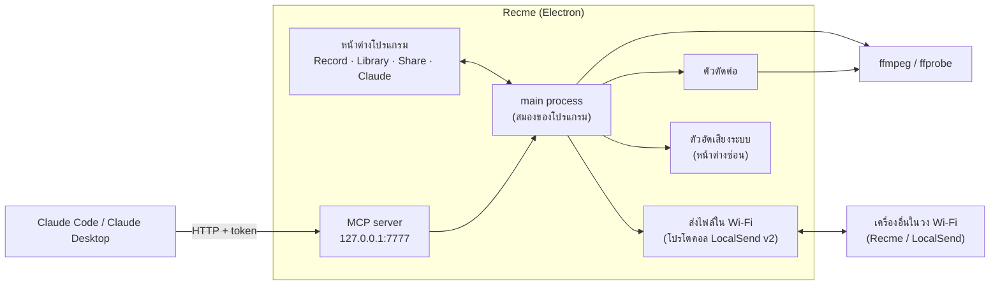
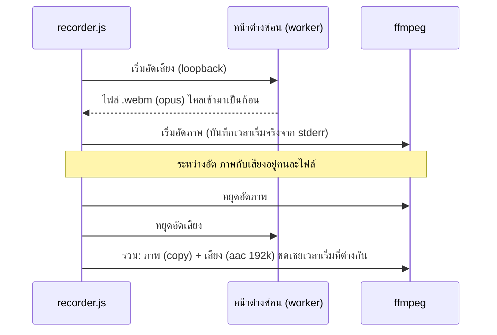
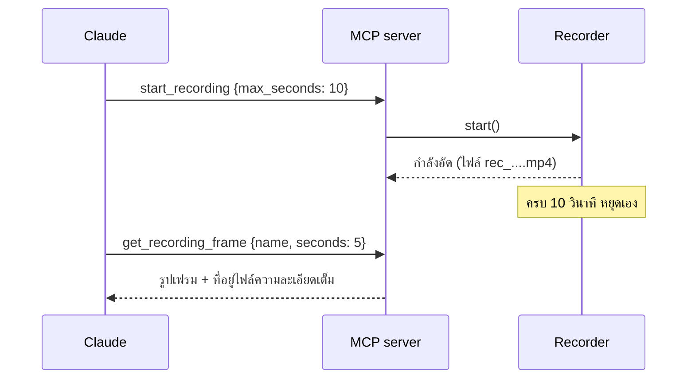

# Recme ทำงานยังไง และใช้อะไรบ้าง

เอกสารนี้อธิบายว่า Recme ประกอบด้วยอะไร แต่ละส่วนทำงานอย่างไร และข้อมูลไหลไปทางไหน เขียนให้คนที่เพิ่งเปิดโค้ดอ่านแล้วเข้าใจภาพรวมได้

> สถานะการทดสอบของแต่ละส่วนอยู่ท้ายเอกสาร (หัวข้อ "ที่ทดสอบแล้ว / ยังไม่ได้ทดสอบ")

---

## 1. ภาพรวมใน 30 วินาที

Recme คือโปรแกรมอัดหน้าจอบน **Windows** สร้างด้วย **Electron** โดยใช้ **ffmpeg** เป็นตัวอัดและตัดต่อจริง และมี **MCP server** ในตัว ทำให้ Claude สั่งอัด/ดู/ตัด/ส่งไฟล์ได้เหมือนคนกดปุ่มเอง



---

## 2. เทคโนโลยีที่ใช้

| ส่วน | ใช้อะไร | ทำไมเลือก |
|---|---|---|
| โปรแกรมเดสก์ท็อป | **Electron 33** (Chromium + Node.js) | เขียน UI ด้วย HTML/JS ได้ มี API จับเสียงระบบ, tray, หน้าต่างโปร่งใส ให้ในตัว |
| จับภาพหน้าจอ | **ffmpeg `gdigrab`** | จับที่ความละเอียดจริงของจอ (เช่น 2880×1800) ไม่ย่อภาพ |
| เข้ารหัสวิดีโอ | **H.264**: `libx264` หรือการ์ดจอ `h264_nvenc` / `h264_qsv` / `h264_amf` | โปรแกรมลองเข้ารหัสทดสอบตอนเริ่ม แล้วเลือกตัวที่ใช้ได้จริงเอง |
| จับเสียงที่ได้ยินจากเครื่อง | **Electron loopback audio** (`getDisplayMedia` + `MediaRecorder`) | ffmpeg บน Windows จับเสียงระบบตรงๆ ไม่ได้ จึงใช้ของ Chromium แล้วค่อยรวมทีหลัง |
| ตัดต่อ / แยกเสียง / กราฟเสียง | **ffmpeg filters** (`trim`, `atrim`, `concat`, `showwavespic`) | ไม่ต้องเขียนตัวถอดรหัสเอง |
| ให้ Claude ควบคุม | **MCP** (`@modelcontextprotocol/sdk`) แบบ Streamable HTTP + `zod` ตรวจรูปแบบอินพุต | มาตรฐานที่ Claude รองรับ |
| ส่งไฟล์ในวง Wi-Fi | **LocalSend v2 protocol** (UDP multicast + REST) | เข้ากับแอป LocalSend ได้ในหลักการ |
| เข้ารหัสการส่งไฟล์ | **HTTPS** ด้วยใบรับรองที่สร้างเอง (`selfsigned`) | fingerprint = SHA-256 ของใบรับรอง เหมือน LocalSend |
| สร้างตัวติดตั้ง | **electron-builder** (NSIS) | ได้ `Recme-Setup-x.y.z.exe` พร้อม ffmpeg ในตัว |

**dependencies ในโปรเจกต์ (มีแค่ 3 ตัว):** `@modelcontextprotocol/sdk`, `zod`, `selfsigned`
**dev:** `electron`, `electron-builder`
**ไบนารีภายนอก:** `ffmpeg.exe`, `ffprobe.exe` (ในตัวติดตั้งแนบไว้ที่ `resources/ffmpeg/`)

---

## 3. โครงสร้างโฟลเดอร์

```
src/
  main.js          สมองหลัก: สร้างหน้าต่าง, tray, config, ผูกทุกส่วนเข้าด้วยกัน, IPC
  recorder.js      ครอบ ffmpeg: เริ่ม/หยุดอัด, เลือก encoder, ต่อ+รวมเสียง, ภาพแคป
  system-audio.js  ตัวอัดเสียงระบบ (คุมหน้าต่างซ่อน)         └ audio/worker.*  ← หน้าเว็บที่อัดเสียงจริง
  mcp-server.js    MCP server (20 เครื่องมือ) + การตรวจสิทธิ์
  windows.js       ดูรายชื่อหน้าต่างที่เปิดอยู่พร้อมตำแหน่ง (PowerShell + Win32 API)
  editor.js        ตัดต่อ/แยกเสียง/กราฟเสียงด้วย ffmpeg
  lan-share.js     ส่ง-รับไฟล์ใน LAN (โปรโตคอล LocalSend v2), PIN, อุปกรณ์ที่ไว้ใจ
  identity.js      สร้าง/โหลดใบรับรอง TLS
  preload.js       สะพานระหว่างหน้าจอ UI กับ main (contextBridge)
  renderer/        หน้าต่างหลัก (4 แท็บ)
  editor/          หน้าต่างตัดต่อ (ไทม์ไลน์)
  overlay/         หน้าจอมืดสำหรับลากเลือกพื้นที่อัด
scripts/           สคริปต์ทดสอบ และสคริปต์ช่วย build (ไอคอน, คัดลอก ffmpeg)
docs/              เอกสารนี้
```

**หลักคิด:** `recorder.js`, `editor.js`, `lan-share.js`, `mcp-server.js` ไม่พึ่ง Electron เลย (เป็น Node ธรรมดา) จึงเขียนเทสต์รันได้โดยไม่ต้องเปิดหน้าต่าง ส่วน `main.js` เป็นตัวเดียวที่ผูกเข้ากับ Electron

---

## 4. แต่ละส่วนทำงานยังไง

### 4.1 การอัดภาพ (`recorder.js`)

1. หา ffmpeg ตามลำดับ: ที่แนบในตัวแอป → ค่าใน config → ตัวแปร `FFMPEG_PATH` → ใน PATH → โฟลเดอร์ WinGet
2. ตอนเริ่มโปรแกรม ลองเข้ารหัสทดสอบ 0.2 วินาทีกับ NVENC / QSV / AMF ตัวไหนผ่านก็ใช้ได้ (ตั้ง "Auto" แล้วเลือกตัวแรกที่ผ่าน ไม่งั้นใช้ `libx264`)
3. ประกอบคำสั่ง ffmpeg: `-f gdigrab -framerate N -draw_mouse 1 -i desktop` (หรือ `-offset_x/-offset_y/-video_size` สำหรับจอเดียว/พื้นที่ หรือ `-i title=...` สำหรับหน้าต่าง)
4. ใส่ฟิลเตอร์ `crop` ให้ความกว้าง/สูงเป็นเลขคู่ (H.264 บังคับ) และติดป้ายสี BT.709 เพื่อให้สีไม่เพี้ยน ไม่มีการ `scale` ย่อภาพ
5. **ระหว่างอัด** เขียนเป็น fragmented MP4 (ถ้าโปรแกรมค้างกลางคันไฟล์ยังเปิดได้) **พอหยุด** แปลงเป็น MP4 ปกติแบบ `faststart` (ไม่เข้ารหัสใหม่ เร็ว) เพื่อให้เล่น/เลื่อนดูได้ทุกที่
6. หยุดอัดโดยส่งตัว `q` เข้า stdin ของ ffmpeg เพื่อให้ปิดไฟล์อย่างถูกต้อง

| พรีเซ็ต | CRF | fps |
|---|---|---|
| Standard | 23 | 30 |
| **High (ค่าเริ่มต้น)** | 18 | 30 |
| Ultra | 14 | 60 |

### 4.2 เสียงระบบ (`system-audio.js` + `audio/worker.js`)



- ไมโครโฟน (ถ้าเลือก) อัดผ่าน DirectShow ของ ffmpeg ตรงๆ แล้วผสมกับเสียงระบบด้วย `amix`
- ข้อควรรู้: เสียงเข้าไฟล์ตอนกดหยุด และอาจเหลื่อมกับภาพเล็กน้อย

### 4.3 เลือกพื้นที่อัด (`overlay/`)

- สร้างหน้าต่างโปร่งใสเต็มจอ "ต่อหนึ่งจอ" ให้ลากกรอบ ปรับขนาด/ย้ายได้ แล้วแปลงพิกัดเป็น **พิกเซลจริง** (คูณสเกลจอ เช่น 175%)
- ระหว่างอัดพื้นที่ มีหน้าต่างกรอบสีแดง **วาดอยู่นอกขอบพื้นที่** และกดทะลุได้ จึงไม่ติดไปในวิดีโอ
- ค่าพิกัดถูกจำกัดให้อยู่ในจอและเป็นเลขคู่ก่อนส่งให้ ffmpeg

### 4.4 MCP server (`mcp-server.js`)

- ฟังที่ `http://127.0.0.1:7777/mcp` เป็น Streamable HTTP แบบ stateless (สร้าง server ใหม่ต่อคำขอ) และปิดการเชื่อมต่อทุกคำขอ (`Connection: close`) กัน client ใช้การเชื่อมต่อค้างที่ Node ปิดไปแล้ว
- **การป้องกัน:** รับเฉพาะ localhost, ต้องมี `Authorization: Bearer <token>` (เปรียบเทียบแบบ timing-safe), ปฏิเสธคำขอที่มี header `Origin` หรือ `Host` แปลก (กันเว็บเพจสั่งผ่านเบราว์เซอร์)
- token สุ่มสร้างครั้งแรก เก็บที่ `%APPDATA%\Recme\config.json` เปลี่ยนได้จากปุ่ม **Reset token** (ใช้ค่าใหม่ทันที ไม่ต้องรีสตาร์ท)

**เครื่องมือที่ Claude เรียกได้ (20 อย่าง):**

| กลุ่ม | เครื่องมือ |
|---|---|
| อัด | `start_recording`, `stop_recording`, `get_status`, `take_screenshot`, `list_displays`, `list_audio_devices` |
| เลือกที่อัด | `list_areas`, `save_area`, `delete_area`, `list_windows` |
| ดูผล | `get_recording_overview`, `list_recordings`, `get_recording_info`, `get_recording_frame` |
| ตัดต่อ | `trim_recording` (ตัด/ต่อ/สลับลำดับ), `extract_audio`, `compress_recording` |
| ส่งไฟล์ | `list_nearby_devices`, `send_recording` |
| จัดการ | `delete_recording` |

ภาพ (แคปจอ, เฟรมจากวิดีโอ) ถูกส่งกลับให้ Claude เป็นรูป ส่วนวิดีโอส่งเป็นไฟล์ในแชทไม่ได้ ให้เป็นที่อยู่ไฟล์แทน

**ตัวอย่างการทำงานเมื่อสั่ง "อัดจอ 10 วินาทีแล้วโชว์เฟรมกลางคลิป":**



### 4.5 ตัวตัดต่อ (`editor.js` + `editor/`)

ข้อมูลหลักคือ **รายการชิ้น (segments)** `[{start, end}, ...]` เป็นช่วงของคลิปต้นฉบับที่ "เก็บไว้" ตามลำดับที่จะต่อกัน

- **ส่งออกให้ไม่เกินขนาด (`Fit under` / `compress_recording`):** คำนวณบิตเรตเฉลี่ยจากขนาดเป้าหมายและความยาว เข้ารหัสด้วย `libx264` (ผลเหมือนกันทุกเครื่อง ไม่ใช่ตัวการ์ดจอ) ลดความละเอียดให้เองถ้างบน้อยเกินไป (ราว 0.07 bit ต่อพิกเซล) และถ้าเกินเป้าหมายจะลองอีกครั้งด้วยบิตเรตที่ลดลง
- **ภาพรวมคลิป (`get_recording_overview`):** ดึงเฟรมเว้นระยะเท่าๆ กันมาต่อเป็นรูปเดียว (ตารางซ้ายไปขวา บนลงล่าง) พร้อมเวลาของแต่ละเฟรม เพื่อให้ Claude เข้าใจทั้งคลิปในการเรียกครั้งเดียว
- **ตัด/ต่อ/สลับลำดับ:** ส่งออกด้วย `filter_complex` (`trim` + `atrim` + `concat`) เข้ารหัสใหม่ด้วย encoder เดียวกับตอนอัด หรือโหมด "fast" ใช้ concat demuxer แบบ copy (ไม่เข้ารหัสใหม่ แต่ตัดได้เฉพาะจุด keyframe)
- **แยกเสียง:** `atrim` + `concat` ออกเป็น m4a / mp3 / wav / flac, "Detach" ได้ 2 ไฟล์ (เสียงล้วน + วิดีโอไม่มีเสียง)
- **กราฟเสียง:** `showwavespic` สร้างรูปเดียวทั้งคลิป แล้วหน้าตัดต่อตัดแบ่งวาดตามชิ้น
- **ไทม์ไลน์ (หน้าต่างตัดต่อ):** แสดง 2 แทร็ก (วิดีโอ/เสียง) มุมมอง "gaps closed" (เรียงชิ้นต่อกันเหมือนผลลัพธ์) หรือ "original positions" ลากแท่งเพื่อสลับลำดับ ลากขอบเพื่อ trim มีแถบเลื่อนและ undo
- ไฟล์ต้นฉบับไม่ถูกแก้ ผลลัพธ์เป็นไฟล์ใหม่ (`_edit`, `_audio`)

### 4.6 ส่งไฟล์ในวง Wi-Fi (`lan-share.js`)

- **ค้นหาเครื่อง:** ประกาศตัวทาง UDP multicast `224.0.0.167:53317` และมีปุ่ม "Find devices" สแกน /24 สำรองกรณี Wi-Fi ปิด multicast
- **ส่ง:** `POST /api/localsend/v2/prepare-upload` (รอผู้รับกด Accept) → `POST .../upload` ทีละไฟล์
- **รับ:** เปิดเซิร์ฟเวอร์ที่พอร์ต 53317 (ถ้าถูกใช้อยู่ถอยไป 53318…) ผู้รับต้องกด Accept ทุกครั้ง เว้นแต่เป็น "อุปกรณ์ที่ไว้ใจ"
- **ความปลอดภัย:**

| เรื่อง | วิธี |
|---|---|
| เข้ารหัส | HTTPS (เปิดเป็นค่าเริ่มต้น) ใบรับรองสร้างเอง เก็บใน `%APPDATA%\Recme\tls` |
| ยืนยันตัวตนผู้รับ | ผู้ส่งตรวจว่า SHA-256 ของใบรับรองตรงกับ fingerprint ที่ประกาศ (ทุกคำขอใช้การเชื่อมต่อใหม่) |
| PIN | ตั้งได้ 4–12 หลัก จำกัดเดาผิด 5 ครั้งต่อนาทีต่อ IP |
| ชื่อไฟล์ | ตัดเส้นทาง/อักขระต้องห้าม/ชื่อสงวนของ Windows ก่อนบันทึก |
| ที่มาของคำขอ | รับเฉพาะ IP วงส่วนตัว (192.168.x, 10.x, 172.16–31.x, localhost) |
| ที่เก็บ | ไฟล์ที่รับเก็บใน `Received` (เปลี่ยนโฟลเดอร์ได้) เขียนลงไฟล์ `.part` ก่อน เสร็จแล้วค่อยเปลี่ยนชื่อ |

### 4.7 พื้นที่อัดที่ตั้งชื่อไว้, หน้าต่าง, และขนาดของฉัน

- **พื้นที่ที่ตั้งชื่อ** (`areas` ใน config) เซฟจากหน้า Record หรือให้ Claude เซฟด้วย `save_area` แล้วอัดด้วย `source: {type: "area", name: "game"}` พิกัดเป็นพิกเซลจริงและถูกปัดเป็นเลขคู่
- **`window_area`**: หาหน้าต่างจากบางส่วนของชื่อ (เช่น "Unity") แล้วอัดสี่เหลี่ยมที่หน้าต่างนั้นอยู่ตอนนี้ ใช้ได้กับหน้าต่างที่วาดด้วย GPU (ต่างจาก `window` ที่ gdigrab อาจได้ภาพดำ)
- **`list_windows`** ใช้ PowerShell + Win32 (`EnumWindows`, `DwmGetWindowAttribute`) และตั้ง DPI-aware เพื่อให้พิกัดเป็นพิกเซลจริง ใช้เวลาราว 1.5 วินาที
- **ขนาดของฉัน (`sizePresets`)**: ใส่ความกว้าง×สูงที่ต้องการแล้วกด "Save this size" จะได้ปุ่มลัดไว้ใช้ซ้ำ (สูงสุด 12 ขนาด)

### 4.8 ปุ่มลัด, การถามก่อน, รีเซ็ต token

- **ปุ่มลัดทั่วระบบ** (ค่าเริ่มต้น `Ctrl+Shift+R`, เปลี่ยนได้ที่หน้า Record → App) ใช้ `globalShortcut` ของ Electron เริ่ม/หยุดอัดด้วยค่าที่ใช้ครั้งล่าสุด (`lastStart` ใน config) เมนูใน tray ใช้ค่าเดียวกัน และมีการแจ้งเตือนของ Windows ตอนเริ่ม/จบ
- **ถามก่อน (`ask` ใน config):** เมื่อ Claude สั่ง ส่งไฟล์ / ลบไฟล์ (เปิดเป็นค่าเริ่มต้น) หรือ อัด/แคปจอ/ดูรายชื่อหน้าต่าง (ปิดเป็นค่าเริ่มต้น) Recme จะเด้งกล่อง Allow/Deny และรอคำตอบสูงสุด 45 วินาที ไม่ตอบ = ปฏิเสธ
- **Reset token:** สร้าง token ใหม่ ตัวเก่าใช้ไม่ได้ทันที

### 4.9 Tray และการเริ่มพร้อม Windows

- ปิดหน้าต่าง = ซ่อนลง **system tray** โปรแกรมยังทำงานต่อ (MCP และการรับไฟล์ไม่หลุด) ออกจริงจากเมนูใน tray
- ไอคอน tray เป็นรูปที่วาดจากโค้ด เปลี่ยนเป็นสีแดงทึบตอนอัด
- ตัวเลือก "เริ่มพร้อม Windows" และ "เริ่มแบบซ่อน" อยู่ที่หน้า Record → App

---

## 5. ข้อมูลและไฟล์ที่โปรแกรมสร้าง

| อะไร | ที่ไหน |
|---|---|
| ตั้งค่า (พอร์ต MCP, token, โฟลเดอร์เก็บไฟล์, ชื่ออุปกรณ์, PIN, รายการที่ไว้ใจ ฯลฯ) | `%APPDATA%\Recme\config.json` |
| ใบรับรอง TLS | `%APPDATA%\Recme\tls\` |
| วิดีโอที่อัด | `Videos\Recme` ตามค่าเริ่มต้น (เปลี่ยนได้ในหน้า Library) ชื่อ `rec_YYYY-MM-DD-HH-MM-SS.mp4` |
| ภาพแคปจอ | โฟลเดอร์เดียวกัน `shot_....png` |
| ไฟล์ที่รับจากเครื่องอื่น | `<โฟลเดอร์เก็บไฟล์>\Received` |

| พอร์ต | ใช้ทำอะไร | เปิดให้ใคร |
|---|---|---|
| 7777 (TCP) | MCP server | เฉพาะเครื่องนี้ (127.0.0.1) |
| 53317–53326 (TCP) | รับไฟล์ | วง LAN |
| 53317 (UDP) | ค้นหาเครื่อง (multicast) | วง LAN |

โปรแกรมไม่ส่งข้อมูลขึ้นอินเทอร์เน็ตเอง

---

## 6. การติดตั้งและใช้งาน

```bash
npm install
npm start              # รันตัวพัฒนา
npm run dist           # สร้างตัวติดตั้ง dist/Recme-Setup-<เวอร์ชัน>.exe
```

เชื่อม Claude Code (คัดลอกคำสั่งพร้อม token จากแท็บ **Claude** ในแอป):

```bash
claude mcp add --transport http recme http://127.0.0.1:7777/mcp --header "Authorization: Bearer <TOKEN>"
```

Claude Desktop ใช้ตัวสะพาน `mcp-remote` (แอปสร้าง JSON ให้คัดลอกในแท็บเดียวกัน)

---

## 7. การทดสอบ

| คำสั่ง | ทดสอบอะไร | ต้องเปิดแอปไหม |
|---|---|---|
| `npm run test:edit` | ตัด/สลับลำดับ/mute/แยกเสียง 4 รูปแบบ, ส่ง-รับไฟล์, ปฏิเสธ, ชื่อไฟล์อันตราย, HTTPS, PIN, อุปกรณ์ที่ไว้ใจ, การตรวจใบรับรอง | ไม่ต้อง |
| `npm run test:mcp` | เรียกเครื่องมือ MCP จริง, token ผิดต้องถูกปฏิเสธ | ต้องเปิด |
| `scripts/test-mcp-edit.js <ไฟล์>` | เครื่องมือตัดต่อ/ส่งไฟล์ผ่าน MCP | ต้องเปิด |
| `npm run test:audio` | อัดพื้นที่พร้อมเสียงที่เล่น แล้วเช็กว่าเสียงเข้าไฟล์ | ต้องเปิด |

---

## 8. ที่ทดสอบแล้ว / ยังไม่ได้ทดสอบ

**ทดสอบแล้ว (รันจริง)**
- อัดจอ/พื้นที่ ที่ความละเอียดจริง, เสียงระบบเข้าไฟล์, ตัด/สลับลำดับ/แยกเสียง, ลากด้วยเมาส์จริงในตัวตัดต่อ
- พื้นที่ตั้งชื่อ, `window_area`, `list_windows`, ส่งออกให้ไม่เกินขนาด (ขอ 3 MB ได้ 2.7 MB), ภาพรวมคลิป, กล่องถามก่อน (ไม่ตอบ = ปฏิเสธ, กด Allow ด้วยคีย์บอร์ด = ทำจริง), ปุ่มลัดด้วยการกดคีย์ระดับระบบ (ใช้ค่าที่ตั้งไว้ครั้งล่าสุด), Reset token, ปุ่มขนาดของฉันด้วยเมาส์จริง
- รับ-ส่งไฟล์ระหว่างสองจุดบนเครื่องเดียว (รวม HTTPS, PIN, หน้าต่างขออนุญาต, อุปกรณ์ที่ไว้ใจ)
- อ่านข้อมูลอุปกรณ์จาก LocalSend ตัวจริงผ่าน HTTPS และตรวจใบรับรองกับ fingerprint ได้ถูกต้อง
- ตัวที่แพ็กแล้ว (`dist\win-unpacked`) อัด/ตัด/แยกเสียงได้ โดยใช้ ffmpeg ที่แนบ

**ยังไม่ได้ทดสอบ**
- ส่งไฟล์ข้ามเครื่องจริง และส่งไฟล์เต็มกับแอป LocalSend ตัวจริง
- การอัดหลายจอ และโหมดอัดตามชื่อหน้าต่าง
- เมนูใน tray (คลิก) และการเปิดพร้อม Windows
- การรันตัวติดตั้ง `Recme-Setup-*.exe` (ทดสอบเฉพาะตัวที่แตกไฟล์แล้ว)
- การกดปุ่ม Reset token / ช่องจับปุ่มลัดด้วยมือ (ทดสอบผ่านคำสั่งไม่ใช่การกดบนหน้าจอ)
- การใช้กับ Unity จริง

---

## 9. ข้อจำกัดที่รู้อยู่แล้ว

- มีเฉพาะ **Windows**
- `gdigrab` ที่จอความละเอียดสูง (2880×1800) ได้ราว 28–29 เฟรม/วินาทีเมื่อตั้ง 30 ตั้ง 60 ไม่น่าจะถึง
- เสียงระบบถูกรวมเข้าไฟล์ตอนหยุดอัด ไม่ใช่ขณะอัด
- ตัวตัดต่อเป็นแบบพื้นฐาน (ไม่มีข้อความ/ทรานซิชัน/หลายแทร็ก/ปรับเสียง)
- ตัวติดตั้งยังไม่ได้ลงนามดิจิทัล Windows SmartScreen อาจเตือน
- ffmpeg ที่แนบมาเป็นรุ่น GPL ถ้าแจกจ่ายต่อต้องทำตามเงื่อนไข GPL
